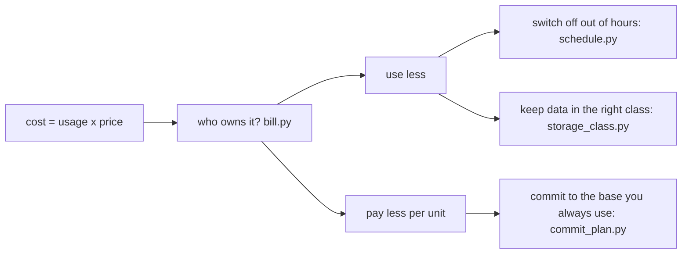

# cloudcost: read a bill, and work out what to change, with arithmetic you can check

A cloud bill is usage multiplied by price, so there are two ways to lower it: use less, or pay less for each unit.
These four small tools do the sums behind the common decisions, on a laptop, with no cloud account. Every price is an
input you can see and change; nothing is looked up behind your back. Standard library only.

Where each tool fits. First find who owns the spend, then pull one of the two levers.



| File | The question | What you will see |
|---|---|---|
| [`bill.py`](bill.py) | Where does the money go, and who owns it? | Totals by service, by owner tag, the untagged share, the top resources |
| [`commit_plan.py`](commit_plan.py) | How much should we commit to? | The weekly cost for every commitment level, and the lowest |
| [`schedule.py`](schedule.py) | What does switching off out of hours save? | 40 of 168 hours: about 76% |
| [`storage_class.py`](storage_class.py) | Which storage class is cheapest for this data? | The answer changes with how often you read it, and how long you keep it |

## Run it

You need Python 3.10 or newer. From this folder:

```bash
python3 bill.py                          # the made-up sample bill: sample_bill.csv
python3 commit_plan.py                   # or: --discount 0.5 --on-demand 0.40
python3 schedule.py                      # or: --hours 10 --days 5 --price 0.40
python3 storage_class.py
```

Run the tests:

```bash
python3 -m pip install pytest
python3 -m pytest
```

## What happens, step by step

**Reading a bill.** `bill.py` reads a CSV with columns named as in
[FOCUS](https://github.com/FinOps-Open-Cost-and-Usage-Spec/FOCUS_Spec), the FinOps Open Cost and Usage
Specification: `ChargePeriodStart`, `ChargeCategory` (Usage, Purchase, Tax, Credit or Adjustment), `ServiceName`,
`ResourceId`, `Tags` (a JSON object) and `BilledCost`. The sample bill is invented. Money is summed as `Decimal`, not
`float`, so the totals are exact to the penny. The first thing it shows is often the most useful: how much of the
bill has no owner.

```text
usage by tag 'team':
  shop             1891.80
  data              687.30
  (untagged)        390.65
  13% of usage has no 'team' tag: nobody is answerable for it
```

**Choosing a commitment.** You pay for a commitment whether you use it or not; usage above it is paid at the
on-demand price. `commit_plan.py` takes a week of hourly usage (4 machines at night, 10 in working hours, 6 during a
nightly batch) and prints the cost of every commitment level:

```text
 commit  weekly cost
      0       984.00
      ...
      4       782.40  <- lowest
      ...
     10      1176.00
```

Committing to the base you always use saves money; committing to the peak costs more than no commitment at all. The
formula gives a rule of thumb, which the tests check against the brute-force answer: commit to the k-th machine only if
you use at least k machines in more than (1 − discount) of the hours.

**Switching off out of hours.** A machine on all week runs 168 hours. AWS's cost guidance uses the example of
development machines needed 40 hours a week, and gives the potential saving as 75%; exactly, it is 1 − 40/168, about 76%.

**Choosing a storage class.** Colder classes cost less to keep, more to read, and charge a minimum duration. The
prices in `storage_class.py` are made up and labelled as such. The last scenario shows the minimum-duration trap:
backups deleted after 30 days are cheaper in "cool" than in "archive", because archive bills for 365 days.

```text
1 TB of backups, never read, deleted after 30 days
  hot          20.00
  cool         10.00
  cold         12.00
  archive      14.60
  cheapest: cool
```

## Try next

1. Export a month of your own bill in FOCUS format, if your provider offers it, and run `python3 bill.py yours.csv`.
   What share has no owner tag?
2. In `commit_plan.py`, change `example_week()` to a week from your own monitoring: one number per hour. Where is the
   lowest point of the curve?
3. Run `python3 commit_plan.py --discount 0.6`. The best commitment stays at 4 machines. Why? (Count the hours with
   5 or more machines in use.)
4. In `storage_class.py`, put in your provider's real prices and add your own scenario. At how many GB read per month
   does "cold" stop being cheaper than "cool"?
5. Add a data-transfer charge to `bill.py`'s report: which resource sends the most data out, and what does it cost?

## Read

- [Cloud Cost](https://enrichmeai.com/well-rounded-engineer/cloudcost/) in the guide: pricing, the two kinds of lever,
  and choosing by requirement.
- [FOCUS specification](https://github.com/FinOps-Open-Cost-and-Usage-Spec/FOCUS_Spec): the column definitions.
- [AWS Well-Architected cost optimization pillar: design principles](https://docs.aws.amazon.com/wellarchitected/latest/cost-optimization-pillar/design-principles.html).
- [Google Cloud Storage classes](https://cloud.google.com/storage/docs/storage-classes): minimum storage durations.
