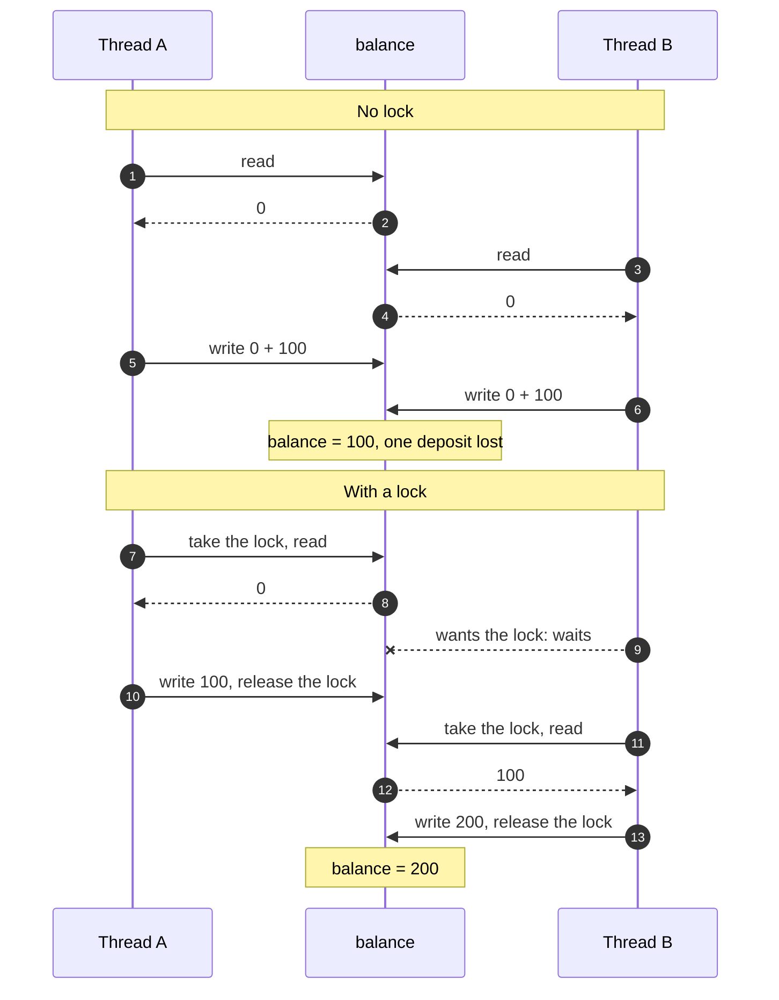
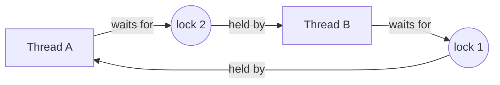
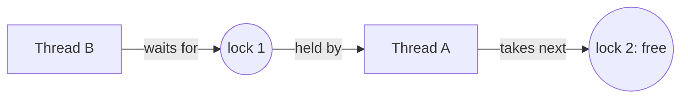
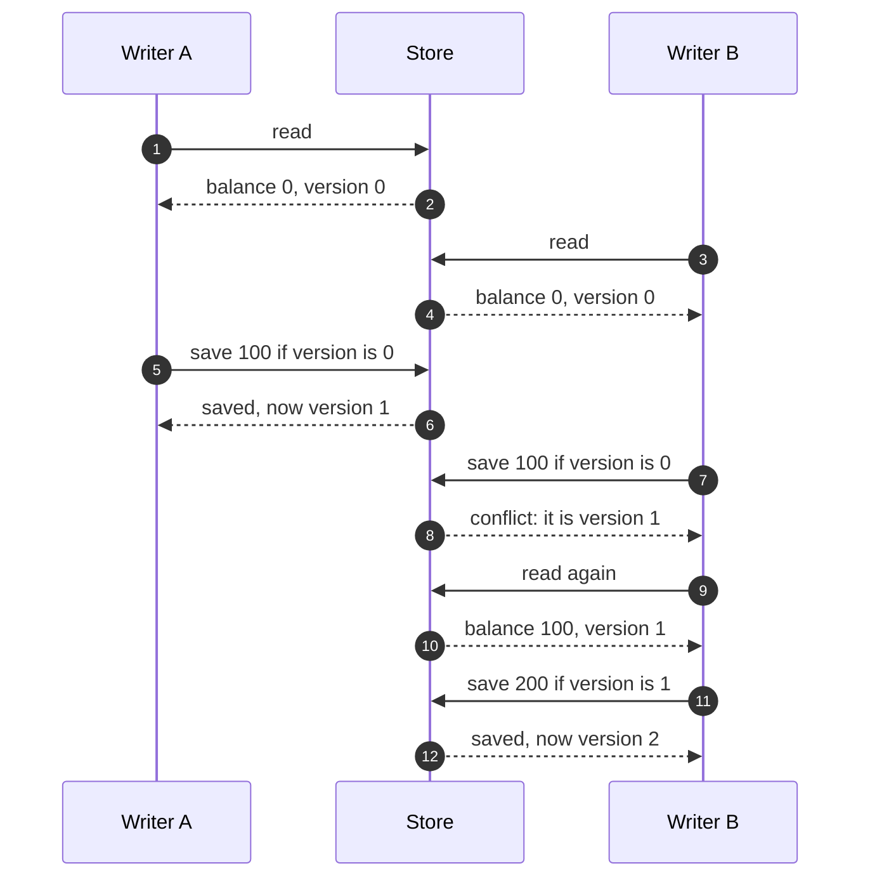
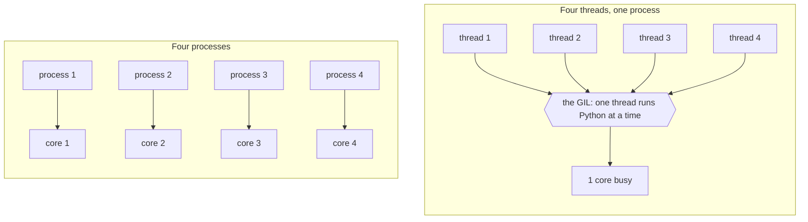
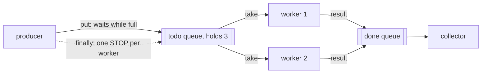
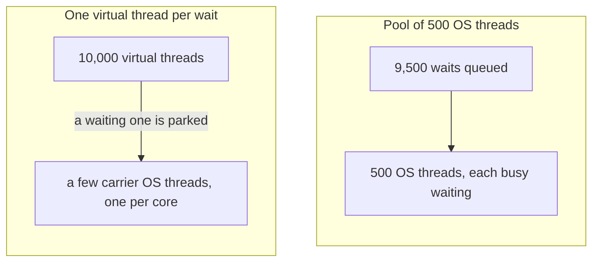

# concurrency: what goes wrong when work overlaps, and the tools that stop it

Two threads changing the same data can lose an update, wait for each other for ever, or slow each other down.
These bugs depend on timing, so they come and go, and they can vanish when you add a print statement. Here each
example **forces** the bad timing (with a `Barrier` or an `Event`), so it happens on every run and you can see
exactly why. Then it shows the fix. Standard library only; one idea per file.

| File | The idea | What you will see |
|---|---|---|
| [`lost_update.py`](lost_update.py) | A race condition, and a lock | Two deposits of 100 give 100 without a lock, 200 with one |
| [`deadlock.py`](deadlock.py) | Deadlock, and lock ordering | Opposite lock orders: both threads stuck; the same order: both finish |
| [`optimistic.py`](optimistic.py) | Optimistic concurrency (a version number) | The second writer is told its data is stale, reads again and retries |
| [`io_vs_cpu.py`](io_vs_cpu.py) | Threads, the GIL, and processes | Threads speed up waiting, not arithmetic; processes speed up arithmetic |
| [`pipeline.py`](pipeline.py) | Passing data through queues instead of sharing it | Orders flow producer → workers → collector with no locks of your own |
| [`amdahl.py`](amdahl.py) | Amdahl's law | 90% parallel work can never go more than 10× faster |

## Run it

You need Python 3.10 or newer. From this folder:

```bash
python3 lost_update.py
python3 deadlock.py        # about two seconds: the timeouts are how it detects the deadlock
python3 optimistic.py
python3 io_vs_cpu.py       # timings depend on your machine: compare the rows, not the numbers
python3 pipeline.py
python3 amdahl.py          # or: python3 amdahl.py 0.5
```

Run the tests:

```bash
python3 -m pip install pytest
python3 -m pytest
```

## What happens, step by step

**Lost update.** Each thread reads the balance (0), then the barrier holds it until the other thread has read too,
then each writes `0 + 100`. The second write overwrites the first. The lock version makes read-and-write one step
that only one thread can be inside at a time.

Read it top to bottom. Without a lock (steps 1 to 6), both threads read 0 before either writes. With a lock (steps 7 to 13), B has to wait until A has finished.



```text
two deposits of 100, unsafe: 100
two deposits of 100, locked: 200
```

**Deadlock.** A takes lock 1 and wants lock 2; B takes lock 2 and wants lock 1. Each holds what the other needs.
A deadlock needs all four of Coffman's conditions: mutual exclusion, hold and wait, no preemption, and circular wait.
Taking the locks in one agreed order removes the circular wait. The demo asks for the second lock with a timeout,
so instead of hanging your terminal it reports who was stuck.

Follow the arrows with opposite orders: A waits for lock 2, which B holds; B waits for lock 1, which A holds. The arrows come back to where they started: a cycle, so neither thread can move.



With one order, both threads ask for lock 1 first. B waits for A, but A is not waiting for B, so there is no cycle: A finishes, then B goes.



```text
opposite orders (A: 1 then 2, B: 2 then 1):
  A holds lock1, stuck waiting for lock2
  B holds lock2, stuck waiting for lock1
same order (both: 1 then 2):
  A took lock1 then lock2
  B took lock1 then lock2
```

**Optimistic concurrency.** No lock is held while working. The save succeeds only if the version is still the one
you read, which is what `UPDATE ... WHERE id = ? AND version = ?` does in a database. A conflict is not an error: you
read again and retry.

Both writers read version 0. A saves first and the version moves to 1, so B's save, which says "only if still version 0", is refused. B reads again and saves on top of A's change.



```text
A: attempt 1 saved 0 -> 100 (version 0 -> 1)
B: attempt 1 conflict (read version 0, it has changed); retrying
B: attempt 2 saved 100 -> 200 (version 1 -> 2)
final balance 200, version 2
```

**Threads, the GIL and processes.** A thread that waits (on the network, a disk, or here `time.sleep`) lets another
run, so ten waits overlap. In standard CPython only one thread runs Python code at a time (the global interpreter lock),
so threads do not speed up arithmetic; separate processes do, because each has its own interpreter. One run on a
4-core machine:

```text
Python 3.13.18, GIL enabled: True
1. ten waits of 0.2 s (I/O-bound)
   one after another : 2.00 s
   ten threads       : 0.20 s
2. four chunks of arithmetic (CPU-bound)
   one after another : 0.54 s
   four threads      : 0.59 s
   four processes    : 0.16 s
```

Why the rows differ: in standard CPython, threads take turns holding one lock (the GIL), so only one runs Python code at a time. Processes each have their own interpreter and their own GIL, so they use separate cores.



**Pipeline.** Each thread owns its data and passes results on through a `queue.Queue`, which does its own locking. A
bounded queue makes a fast producer wait for slow workers (back-pressure). One `STOP` value per worker shuts it down.

Data moves left to right and no thread touches another's. The first queue holds at most 3 orders, so a fast producer waits for the workers: back-pressure.



**Amdahl's law.** With a fraction `p` that can run in parallel on `s` processors, the speed-up is
`1 / ((1 - p) + p / s)`. The serial part sets the ceiling.

## The same examples in Java

[`java/`](java/) holds the same six programs in Java, file for file, printing the same results, so you can read the
two side by side. Nothing to install but a JDK, version 21 or newer: since Java 11 the `java` command runs a source
file directly ([JEP 330](https://openjdk.org/jeps/330)), with no build tool in between. From `java/`:

```bash
java LostUpdate.java
java Deadlock.java
java Optimistic.java
java IoVsCpu.java
java Pipeline.java
java Amdahl.java           # or: java Amdahl.java 0.5
javac -d out *.java && java -cp out ConcurrencyTests
```

| Python | Java | What changes |
|---|---|---|
| `threading.Lock`, `with lock:` | `synchronized (lock) { ... }` | The same idea, built into the language |
| *(none in the standard library)* | `AtomicInteger.addAndGet` | One indivisible read-add-write, with no lock of your own: `LostUpdate.java` shows it as a third fix |
| `lock.acquire(timeout=...)` | `ReentrantLock.tryLock(timeout, unit)` | `synchronized` has no timeout, so `Deadlock.java` uses the lock classes |
| `threading.Barrier`, `threading.Event` | `CyclicBarrier`, `CountDownLatch` | The same jobs: wait for each other; wait for a signal |
| `@dataclass(frozen=True)` | `record Row(int balance, int version)` | An immutable value |
| `queue.Queue(maxsize=3)` | `ArrayBlockingQueue<>(3)` | A queue that does its own locking and blocks when full |
| threads for waiting, processes for arithmetic | threads for both, virtual threads for many waits | Below: the biggest difference |

**Threads and arithmetic: the biggest difference.** The JVM has no global interpreter lock. Each ordinary Java thread
is an operating-system thread, and several run Java code at the same moment on different cores, so four threads speed
up arithmetic where four CPython threads did not. Part 3 adds what Python's threads do not have: an operating-system
thread is costly, so programs cap them with a pool, while a virtual thread (Java 21,
[JEP 444](https://openjdk.org/jeps/444)) is scheduled by the JVM and parked while it waits, so one per task is cheap.
Virtual threads make waiting cheaper; they do not make arithmetic faster. One run on the same 4-core machine:

```text
Java 21, 4 processors
1. ten waits of 0.2 s (I/O-bound)
   one after another : 2.00 s
   ten threads       : 0.20 s
2. four chunks of arithmetic (CPU-bound)
   one after another : 0.61 s
   four threads      : 0.23 s
3. 10,000 waits of 0.1 s
   pool of 500 OS threads      : 2.08 s
   one virtual thread per wait : 0.21 s
```

Part 3, drawn. An OS thread is costly, so a pool caps them and the rest of the work queues. Virtual threads are cheap: the JVM runs them on a few OS threads and parks one while it waits, so all 10,000 can wait at once.



The two `arithmetic` rows are not comparable across languages: the Java chunk is a much longer loop, because the JIT
compiler turns it into machine code that runs it far faster than CPython's interpreter. Compare the rows within each
language.

The other five programs print exactly what their Python twins print, plus one line from `LostUpdate.java`:

```text
two deposits of 100, unsafe: 100
two deposits of 100, locked: 200
two deposits of 100, atomic: 200
```

## Try next

1. In `lost_update.py`, delete the `both_have_read.wait()` line and run it again. You will probably see 200 every
   time: the first thread finishes before the second starts. The race has not gone; the timing hides it, which is how
   races survive testing. To see it without the barrier, make each thread do 10,000 deposits of 1 in a loop and put
   `time.sleep(0)` between the read and the write, standing in for real work such as a database call. On our machine
   two threads ended near 10,000 instead of 20,000: about half the updates were lost.
2. In `deadlock.py`, add a `lock3` to the `locks` dictionary and pass three-name orders, with the worker taking all
   three in turn. Which orders deadlock? (Rule of thumb: any two threads that take some pair of locks in opposite
   orders.)
3. In `optimistic.py`, add a third writer. Change `Barrier(2)` to `Barrier(3)` and give the third writer a hook that
   waits for B to save, like `wait_for_a` does for A. How many retries happen in total?
4. In `io_vs_cpu.py`, replace the threads in part 1 with `asyncio.gather` and `asyncio.sleep`. One thread, the same
   overlap.
5. In `pipeline.py`, make the workers slow (`time.sleep(0.1)` per order) and add
   `print("producer waiting to put", order["id"])` just before `out.put(order)`. With `maxsize=3` the producer stops
   and waits for the workers: that is back-pressure.
6. Now add an order for an item that is not in `prices`. The worker dies with a `KeyError`, never sends `STOP`, and
   `run()` waits for ever. This is the classic queue-pipeline trap: catch errors in the worker, report them, and
   still send `STOP`.
7. Run `python3 amdahl.py 0.99`. How many processors does it take to get half of the ceiling?
8. In `java/LostUpdate.java`, remove the `synchronized` block but keep the two lines inside it, and run each thread
   10,000 times in a loop. Unlike the Python try-next, you need no `sleep`: Java threads really run at the same time
   on different cores, so updates go missing on their own. In five runs on our machine, four ended between 15,241 and
   19,001 instead of 20,000; one got lucky and reached 20,000, which is why a passing run proves nothing.
9. In `java/IoVsCpu.java`, give part 3 a pool of 10,000 OS threads instead of 500. Does it start them, how long
   does it take, and how much memory does the process use while it runs?

## Read

- [Concurrency](https://enrichmeai.com/well-rounded-engineer/concurrency/) in the guide.
- [Distributed Systems](https://enrichmeai.com/well-rounded-engineer/distsys/): the same problems across machines.
- Python docs: [`threading`](https://docs.python.org/3/library/threading.html),
  [`queue`](https://docs.python.org/3/library/queue.html),
  [`concurrent.futures`](https://docs.python.org/3/library/concurrent.futures.html).
- Java docs (21): [`java.util.concurrent`](https://docs.oracle.com/en/java/javase/21/docs/api/java.base/java/util/concurrent/package-summary.html),
  [`ReentrantLock`](https://docs.oracle.com/en/java/javase/21/docs/api/java.base/java/util/concurrent/locks/ReentrantLock.html),
  [JEP 444: Virtual Threads](https://openjdk.org/jeps/444).
- [How Java threads evolved](https://enrichmeai.com/well-rounded-engineer/javathreads/) in the guide.
