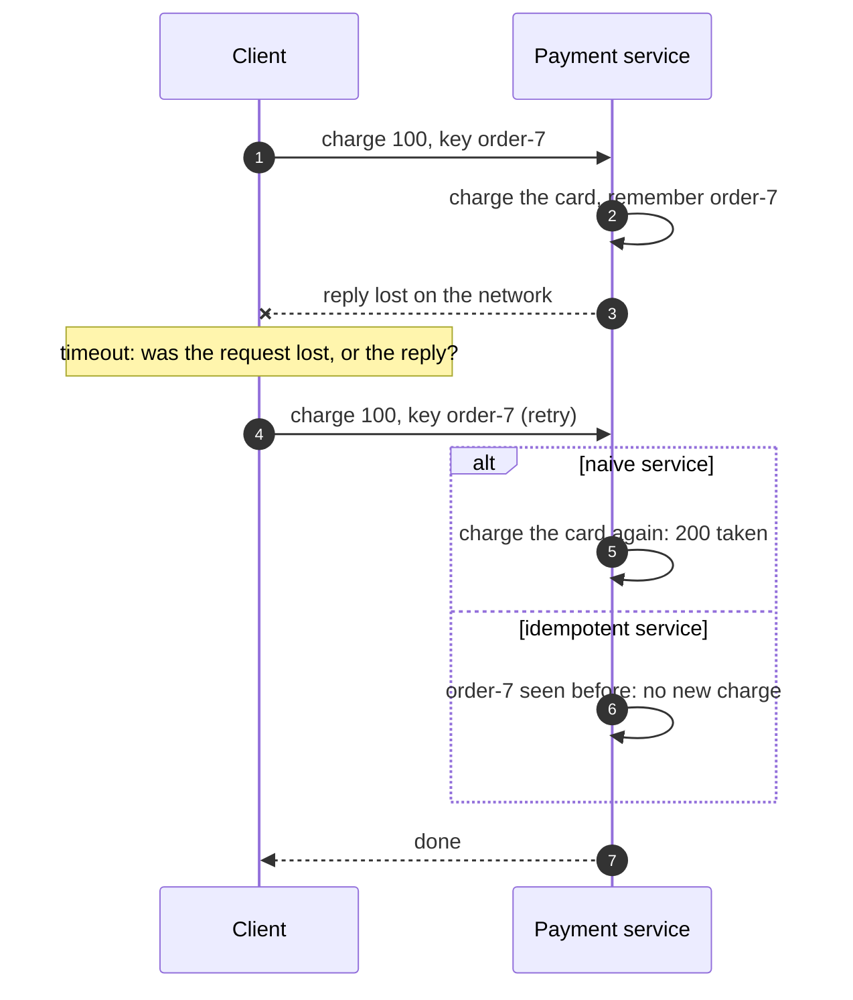
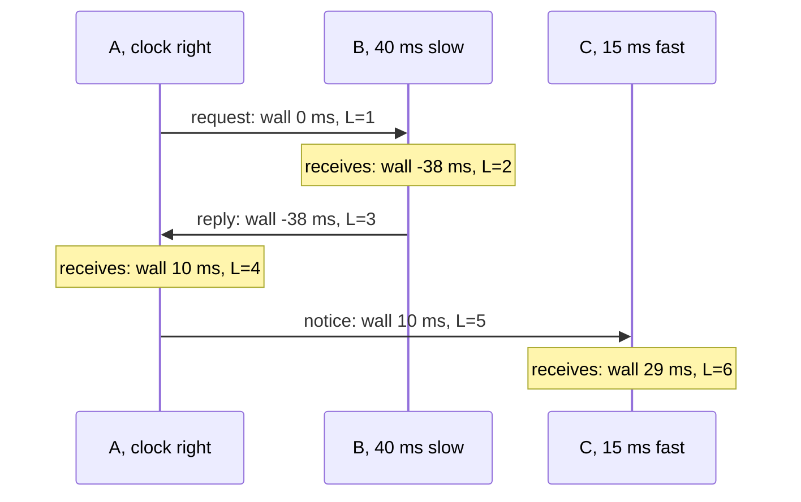
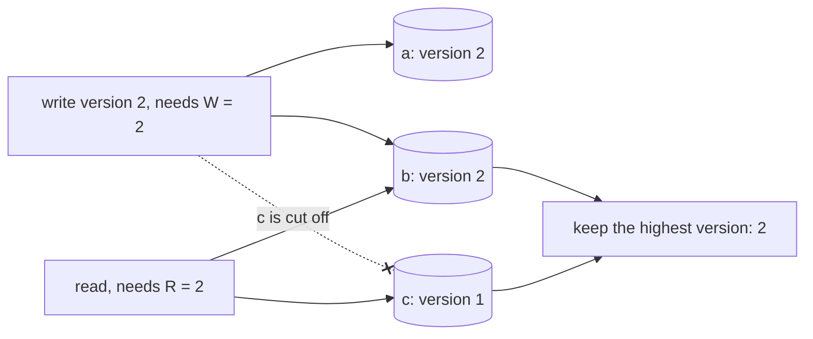
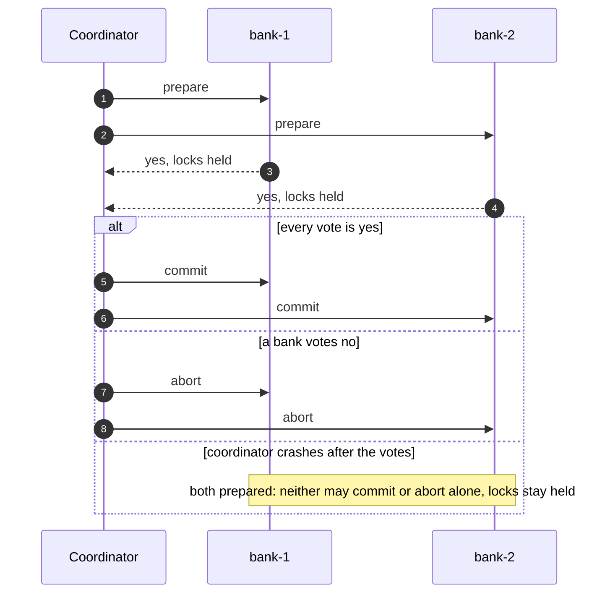
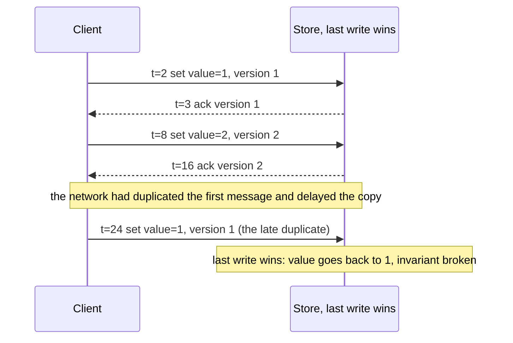
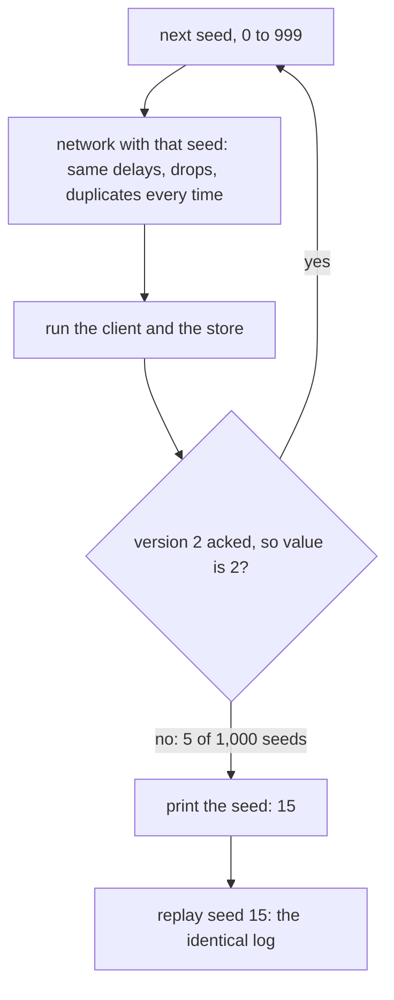

# distsys: what goes wrong between machines, simulated so you can watch it

Messages get lost, delayed and delivered twice; clocks disagree; a machine stops halfway. On real machines these
problems come and go, so they are hard to see and harder to reproduce. Here every example runs on
[`sim.py`](sim.py): a tiny network simulator with a simulated clock and one **seeded** random-number generator. The
network loses, delays and duplicates messages, but the same seed always gives the same run, message for message.
Standard library only; no threads, no sockets.

| File | The idea | What you will see |
|---|---|---|
| [`sim.py`](sim.py) | Deterministic simulation: messages, delays, drops, duplicates, partitions, timers | The engine the others run on |
| [`idempotency.py`](idempotency.py) | Retries after a lost reply, and idempotency keys | 20 orders of 100: charged 2,900 without a key, 2,000 with one |
| [`lamport.py`](lamport.py) | Wall clocks vs Lamport clocks | By wall clock, B receives a request 38 ms before A sends it |
| [`quorum.py`](quorum.py) | Read and write quorums: W + R > N | Stale reads whenever W + R ≤ N; never when W + R > N |
| [`two_phase_commit.py`](two_phase_commit.py) | Two-phase commit, and why it blocks | Coordinator crashes after the votes: both banks stuck, locks held |
| [`dst.py`](dst.py) | Deterministic simulation testing | A rare bug found in 5 of 1,000 schedules, replayed exactly from its seed |

## Run it

You need Python 3.10 or newer. From this folder:

```bash
python3 idempotency.py
python3 lamport.py
python3 quorum.py
python3 two_phase_commit.py
python3 dst.py
python3 -m pip install pytest && python3 -m pytest
```

## What happens, step by step

**Retries and idempotency.** The client cannot tell a lost request from a lost reply, so after a timeout it sends
the charge again. When it was the reply that was lost, a naive service charges twice. An idempotency key lets the
service recognise the retry and return its first answer instead. The network here loses 30% of messages:

```text
NaivePayments       customer owed 2000, charged 2900 (40 requests sent for 20 orders)
IdempotentPayments  customer owed 2000, charged 2000 (40 requests sent for 20 orders)
```

One order, step by step. The charge succeeds, but its reply is lost, so the client cannot tell whether it worked and sends the same request again.



**Clocks.** B's clock runs 40 ms behind A's, and C's 15 ms ahead. Sorted by wall clock, the logs put B's reply before
A's request. A Lamport clock is a counter: add one for each local event, send it with every message, and on receipt
set it to the larger of your own and the sender's, plus one. If one event caused another, its counter is smaller.

The run in `lamport.py`. B's clock is 40 ms slow, so its wall-clock times come before A's, yet B cannot reply before A asks. The Lamport counter L follows the messages, so it gets the order right.



```text
sorted by wall clock (what the logs say):
  wall  -38 ms  B receives request
  wall  -38 ms  B sends reply
  wall    0 ms  A sends request
  wall   10 ms  A receives reply
  wall   10 ms  A tells C
  wall   29 ms  C receives notice
sorted by Lamport clock (respects cause and effect):
  L=1         A sends request
  L=2         B receives request
  L=3         B sends reply
  L=4         A receives reply
  L=5         A tells C
  L=6         C receives notice
```

**Quorums.** Three replicas; replica c is cut off during a write and comes back still holding the old value. A read
keeps the highest version among the replicas it asks. When W + R > N, every read set shares a replica with every
write set, so it sees the newest version. Asking for all three during the partition is the other side of the trade:
consistent, but the write is refused.

N = 3, W = 2, R = 2. The write reaches a and b while c is cut off. Any two replicas a read asks must include at least one of a and b, so the read always sees version 2.



```text
N=3 W=1 R=1  W+R<=N  stale when reading b, c
N=3 W=2 R=1  W+R<=N  stale when reading c
N=3 W=1 R=2  W+R<=N  stale when reading b+c
N=3 W=2 R=2  W+R>N  always sees the latest
N=3 W=3 R=1  W+R>N  only 2 of the 3 replicas needed are reachable: write refused (consistent, but not available)
```

**Two-phase commit.** A participant that votes yes has promised to commit if told to, so it holds its locks and
waits. If the coordinator crashes after collecting the votes, neither bank can safely decide on its own:

```text
both vote yes                       : {'bank-1': 'committed', 'bank-2': 'committed'}
bank-2 votes no                     : {'bank-1': 'aborted', 'bank-2': 'aborted'}
coordinator crashes after the votes : {'bank-1': 'prepared', 'bank-2': 'prepared'} <- both stuck holding their locks
```

Phase 1 collects votes, phase 2 sends the decision. A bank that voted yes has promised to obey, so if the decision never comes it can only wait, holding its locks.



**Deterministic simulation testing.** A client sets a key to 1, then to 2. The network occasionally duplicates a
message and delays messages by different amounts. The invariant: once the second write is acknowledged, the store
holds 2. A store that applies whatever arrives last breaks it, but only when a duplicate of the first write is
delayed past the second, which a normal test run will seldom hit. `dst.py` tries 1,000 seeded schedules, finds the
ones that fail, and replays the first one exactly. A store that keeps a version number and ignores older writes
passes all of them.

```text
buggy store: invariant broken in 5 of 1000 seeds, first at seed 15
replay seed 15:
    t=2    client->store set value=1 version=1
    t=3    store->client ack version=1
    t=8    client->store set value=2 version=2
    t=16   store->client ack version=2
    t=24   client->store set value=1 version=1
    t=36   store->client ack version=1
replaying it again gives the identical log: True
fixed store: invariant broken in 0 of 1000 seeds
```



At t=24 the delayed duplicate of the first write arrives, and the buggy store goes back to 1.

Above: the search loop in `dst.py`. Below: the failing schedule it found, seed 15, message by message.



## Try next

1. In `idempotency.py`, set `drop=0.0`. Do the two services still differ? Why does the problem need lost messages?
2. In `lamport.py`, add a fourth server that receives nothing. Its events get small counters: Lamport clocks order
   only events connected by messages, not everything. (Vector clocks go further.)
3. In `quorum.py`, try N = 5. Which (W, R) pairs always see the latest write?
4. In `two_phase_commit.py`, let the coordinator crash after sending `commit` to only one bank. What does each bank
   hold, and what would a recovery process have to do?
5. In `dst.py`, raise `duplicate` to 0.2. How many seeds fail now? Then add a second client, and check the invariant
   still makes sense.

## Read

- [Distributed Systems](https://enrichmeai.com/well-rounded-engineer/distsys/) in the guide.
- Unmesh Joshi, [Deterministic Simulation Testing](https://martinfowler.com/articles/deterministic-simulation-testing.html)
  and [Patterns of Distributed Systems: Majority Quorum](https://martinfowler.com/articles/patterns-of-distributed-systems/majority-quorum.html).
- Wikipedia: [Lamport timestamp](https://en.wikipedia.org/wiki/Lamport_timestamp),
  [Two-phase commit protocol](https://en.wikipedia.org/wiki/Two-phase_commit_protocol),
  [Quorum (distributed computing)](https://en.wikipedia.org/wiki/Quorum_(distributed_computing)).
