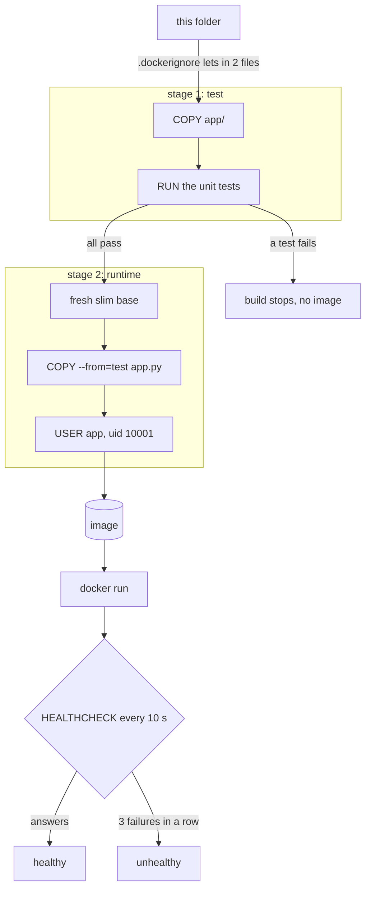

# docker: a Dockerfile done right

A Dockerfile is easy to write and easy to write badly: a huge image, running as root, with your whole laptop
folder copied in and no way for Docker to know whether the app inside is actually working. This folder puts a
tiny Python web app (standard library only) in a container the careful way, and the notes below explain why
each line is there.

## Run it

You need [Docker](https://docs.docker.com/get-started/get-docker/). From this folder:

```bash
docker build -t wre-docker-example .
docker run --rm -p 127.0.0.1:8080:8080 wre-docker-example
```

Then, in another terminal:

```bash
curl http://127.0.0.1:8080/          # {"message": "Hello from inside a container", "uid": 10001}
curl http://127.0.0.1:8080/health    # ok
docker ps                            # the STATUS column shows (healthy) after a few seconds
```

Run all the checks: the unit tests without Docker, and then the whole container from the outside (build, wait
for healthy, call it, confirm it is not root):

```bash
(cd app && python3 -m unittest -v)
bash test-container.sh               # set PORT=9090 first if 8080 is taken
```

What `docker build` and `docker run` do with this folder. The tests run inside the build: if one fails, there is no image to run.



## Why each choice

| In the Dockerfile | Why |
|---|---|
| `FROM python:3.13.18-slim-trixie` | A **pinned tag**: the exact Python release on a named Debian release (trixie). `python:latest` changes under you, so the same Dockerfile could build something different next month. `slim` leaves out compilers and docs you do not need at run time. |
| Two `FROM` lines (`test`, then `runtime`) | A **multi-stage build**. The first stage runs the unit tests; if one fails, the build fails. The second stage starts clean and copies in only `app.py`, so the tests never ship. |
| `COPY --from=test ...` | Besides copying the file, this makes the runtime stage depend on the test stage. Docker's builder skips stages nothing depends on, so without it the tests would silently not run. |
| `groupadd` / `useradd`, then `USER app` | A **non-root user**. If someone breaks into the app, they are an ordinary user inside the container, not root. The app's own file stays owned by root, so the app cannot rewrite itself. |
| `ENV PYTHONUNBUFFERED=1` | Logs appear in `docker logs` straight away instead of sitting in a buffer. |
| `EXPOSE 8080` | Documents the port the app listens on. It does not publish it: `-p` on `docker run` does that. |
| `HEALTHCHECK ... /health` | Docker asks the app every 10 seconds whether it is working, and marks the container `healthy` or `unhealthy`. A running process is not the same as a working app. The slim image has no `curl`, so the check uses Python. |
| `CMD ["python", "app.py"]` | The **exec form** (a JSON list). Python runs as the container's main process and receives the stop signal from `docker stop` directly, so it can shut down cleanly. |
| `.dockerignore` | Sends Docker only the two files the build needs. Everything else in the folder (and any secrets lying around) stays out of the build and out of the image. It lists what to *let in*, which is safer than listing what to keep out. |

## Try next

1. Run `docker run --rm wre-docker-example id`. It prints `uid=10001(app)`. Now remove the `USER app` line,
   rebuild, and run it again.
2. Break a test in `app/test_app.py` (change `b"ok\n"` to `b"broken"`) and rebuild. The build stops at the test
   stage and no image is made.
3. Change the health check URL from `/health` to `/nope`, rebuild, run it, and watch `docker ps`. After about
   half a minute (three failed checks, ten seconds apart) the container turns `unhealthy`.
4. Compare sizes: `docker image ls`. Try `python:3.13.18-alpine3.23` as the base. What gets smaller, and what
   might break?

## Read

- [Docker](https://enrichmeai.com/well-rounded-engineer/docker/) in the guide.
- The [Dockerfile reference](https://docs.docker.com/reference/dockerfile/) for every instruction used here.
