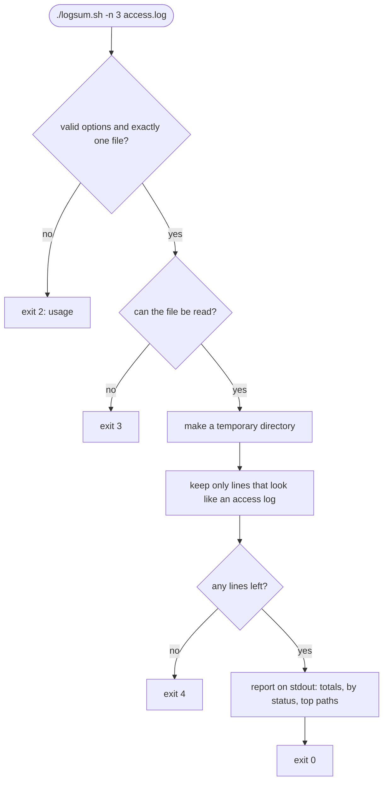

# linux: a shell script that behaves well

Most shell scripts work until the day they do not, and then they fail quietly. `logsum.sh` does a small real
job, summarising a web server access log, and shows the habits that make a script safe to rely on:
`set -euo pipefail` so errors stop it instead of being ignored, `getopts` for options, clear exit codes for each
kind of failure, a `trap` that cleans up its temporary files however it ends, and messages on stderr so the
report on stdout can be piped somewhere clean.

The path through `logsum.sh`. Each way out has its own exit code, and the `trap` deletes the temporary directory whichever way the script ends.



## Run it

You need bash (Linux, macOS, or WSL on Windows). From this folder:

```bash
./logsum.sh sample-access.log
./logsum.sh -n 3 -v sample-access.log     # top 3 paths, and say what it is doing
./logsum.sh -h                            # help
```

The exit code tells you what happened. Check it with `echo $?` straight after a run:

| Code | Meaning |
|---|---|
| 0 | success |
| 2 | usage error: a bad option or a missing file argument |
| 3 | the file does not exist or cannot be read |
| 4 | the file has no lines that look like an access log |

Run the tests (plain bash, no framework to install):

```bash
bash tests/test_logsum.sh
```

The script also passes [ShellCheck](https://www.shellcheck.net/), a linter for shell scripts. To run it:
`python3 -m pip install shellcheck-py`, then `shellcheck logsum.sh tests/test_logsum.sh`.

## Try next

1. Run `./logsum.sh -v sample-access.log > report.txt`. The progress messages still appear on your screen and
   only the report goes into the file. That is what logging to stderr buys you.
2. Delete the `trap cleanup EXIT` line and run the tests. Two fail: the temporary directory is left behind.
   Put the line back.
3. Add a `-s STATUS` option that only counts requests with that status code, with a test for it and for a bad
   value (exit code 2).
4. Point it at a real log, for example `/var/log/nginx/access.log` if you run nginx. What does it skip?

## Read

- [Linux](https://enrichmeai.com/well-rounded-engineer/linux/) in the guide.
