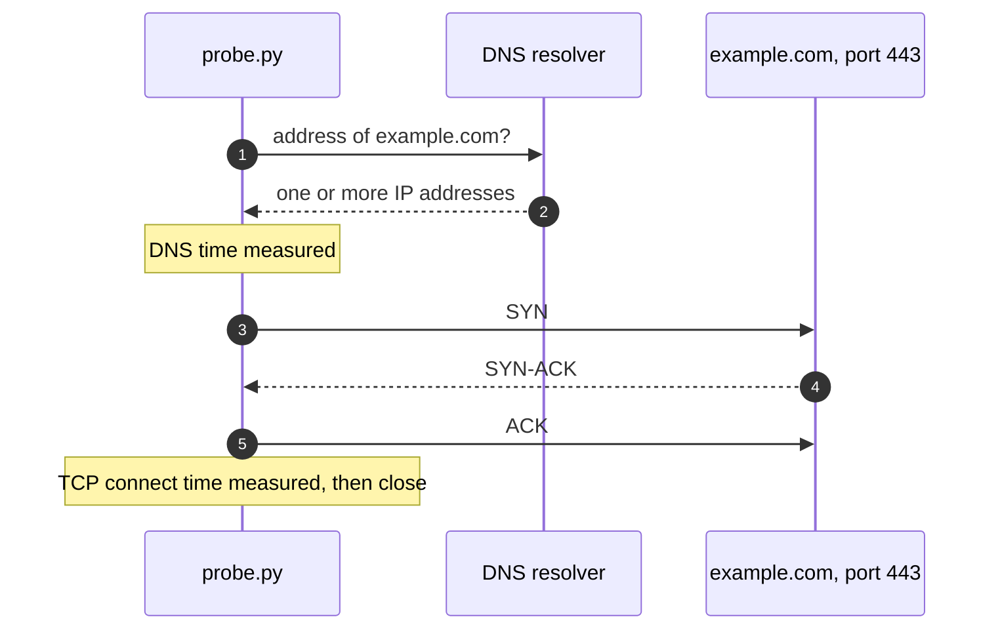
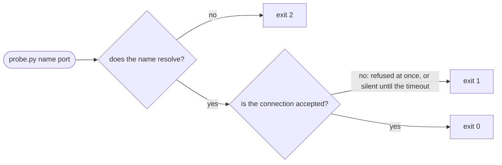

# networking: what happens before the first byte

Before your browser can send a single byte to `example.com`, two things must happen. First, the name is turned
into an IP address (a **DNS** lookup). Then a **TCP** connection is opened to that address on a port, such as
443 for HTTPS, with a three-way handshake. Each step takes time, and each can fail in its own way. `probe.py`
does just those two steps, times them, and tells you which one failed. It sends no data. Standard library only.

The two steps `probe.py` times. A DNS lookup turns the name into addresses; the TCP handshake opens a connection. Then it closes without sending any data.



## Run it

You need Python 3.10 or newer. From this folder:

```bash
python3 probe.py example.com 443     # DNS: example.com -> <addresses> (x ms), then TCP: connected ... (y ms)
python3 probe.py localhost 22        # is anything listening on port 22 on your own machine?
python3 probe.py no-such-name.invalid 80
```

The exit code tells you which step failed (`echo $?` straight after a run): `0` connected, `1` the name resolved
but nothing accepted the connection, `2` the name did not resolve.

Which step failed decides the exit code.



Run the tests. They use only your own machine (localhost), so they work offline:

```bash
python3 -m pip install pytest
python3 -m pytest
```

## Try next

1. Run the same probe twice in a row. Is the second DNS lookup faster? Something between you and the DNS
   server is caching the answer.
2. Probe a port nothing listens on, on your own machine (`python3 probe.py 127.0.0.1 1`): you get
   "Connection refused" at once. Now probe an address that does not answer at all, such as `10.255.255.1 80`
   (on most home networks): it waits for the whole timeout instead. Refused and silent are different failures.
3. Compare `python3 probe.py localhost 22` with the answer from `dig localhost` or `nslookup localhost`, if you
   have them. Does the name give you an IPv6 address (`::1`) as well as `127.0.0.1`?
4. Add a `--count N` option that probes N times and prints the fastest, slowest and average connect time.

## Read

- [Networking](https://enrichmeai.com/well-rounded-engineer/networking/) in the guide.
