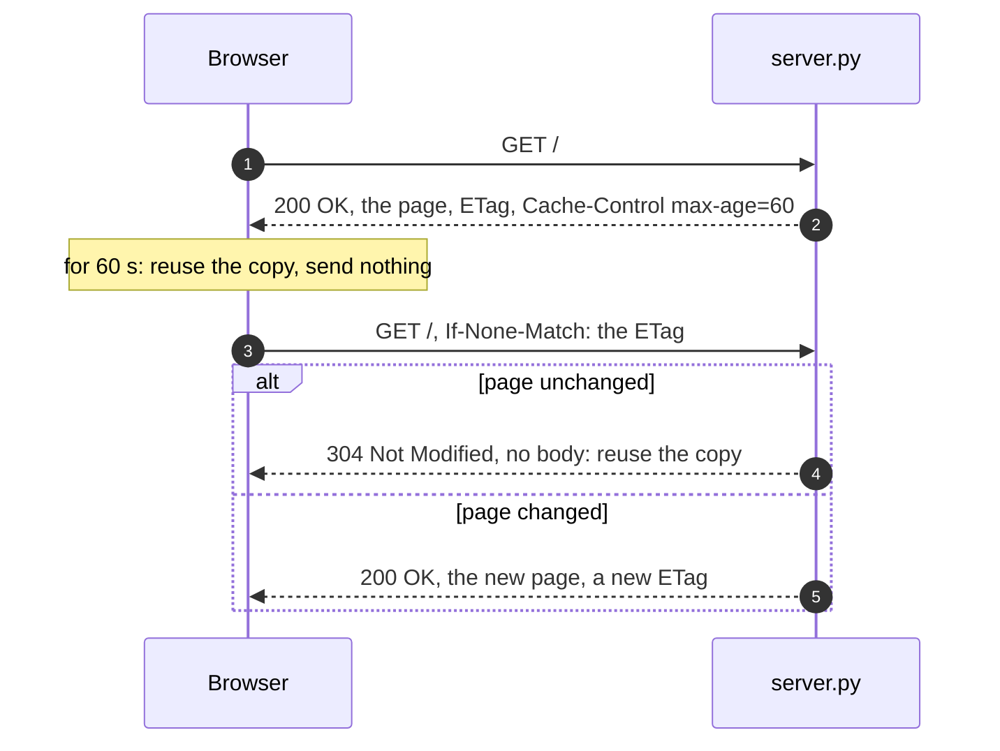

# web: HTTP caching, made visible

A browser does not download a page every time. The server can say "you may keep this for 60 seconds"
(`Cache-Control`) and give the page a fingerprint (`ETag`). When the browser asks again, it sends the
fingerprint back in `If-None-Match`. If the page has not changed, the server answers `304 Not Modified`
with no body, and the browser reuses the copy it already has. This folder is a tiny Python server, standard
library only, that does exactly that, so you can watch it happen with `curl` or your browser's developer tools.

What `server.py` and the browser say to each other. The page is kept for 60 seconds; after that, the browser asks "has it changed?" and gets either an empty 304 or the new page.



## Run it

You need Python 3.10 or newer. From this folder:

```bash
python3 server.py                 # serves http://127.0.0.1:8000/ ; Ctrl+C to stop
```

In a second terminal, run the curl walkthrough. It makes one normal request, then repeats it with the ETag:

```bash
./demo.sh                         # or: ./demo.sh http://127.0.0.1:8000/
```

You will see `HTTP/1.0 200 OK` with `ETag` and `Cache-Control` headers, then `HTTP/1.0 304 Not Modified` with
no body. (Python's built-in server speaks HTTP/1.0; the caching headers work the same way.)

Run the tests (they start the server on a free port by themselves):

```bash
python3 -m pip install pytest
python3 -m pytest
```

## Try next

1. Change a word in `PAGE` in `server.py`, restart the server, and send the old ETag again. You get a `200`
   with a new ETag, because the fingerprint follows the content.
2. Open http://127.0.0.1:8000/ in a browser with the Network tab open. Reload normally, then do a hard reload
   (in most browsers, hold Shift while you click Reload). Compare the request headers the browser sends each time.
3. Change `Cache-Control` to `no-store` and see what your browser does on reload. Then try `no-cache`, which
   sounds the same but is not: it means "check with the server before reusing", not "never keep".
4. Add a `Last-Modified` header and support `If-Modified-Since`, the older, date-based way to ask
   "has this changed?". Write a test for it first.

## Read

- [The web](https://enrichmeai.com/well-rounded-engineer/web/) in the guide.
- Going further: [caching](https://enrichmeai.com/well-rounded-engineer/caching/).
